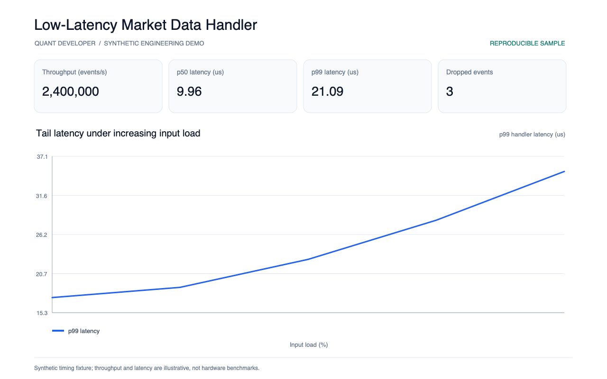
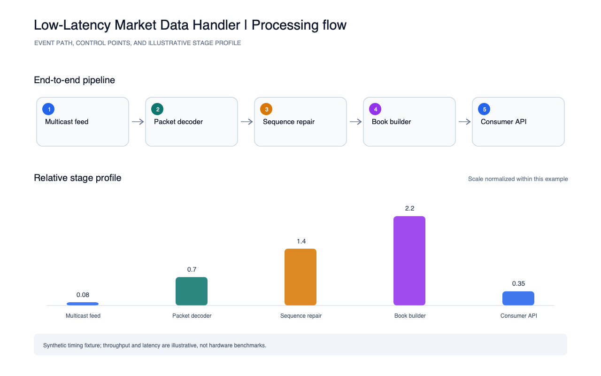

# Low-Latency Market Data Handler

A compact event-pipeline demonstration reporting latency percentiles, event throughput, dropped messages, and an illustrative load/latency curve.

Run `python3 run.py` to write `reports/metrics.json`.

Run the smoke test with `python3 -m unittest discover -s tests -v`. The report images were generated from these metrics by the portfolio's shared screenshot script.

Timing and throughput values are deterministic synthetic fixtures, not measurements from a specific host, feed, or production system.
